# INTERNATIONAL CYBERSECURITY AND DIGITAL FORENSICS ACADEMY

## GRC103: Risk Assessment and Management Techniques

### Week 3 Practical Laboratory:
# Technical Risk Treatment - Implementing and Validating Security Controls

**Full Name:** Venesha Adhiambo Ochieng  
**Registration Number:** C11/26/CGRCE/17566  
**Email Address:** c11.cgrce2617566@icdfa.edu.ng  
**Cohort / Batch:** Cohort11  
**Date Submitted:** 6th November 2026

---

You are the GRC analyst and technical control implementer for a fictional organisation, Northbridge Services. Its internal document server exposes a legacy endpoint and a directory of dummy files. Management requires measurable risk treatment without interrupting the approved web service.

## Required Local Environment

Use two VMs on your own computer: Ubuntu Server 24.04 LTS (2 vCPUs, 2–4 GB RAM, 25 GB disk) and Kali Linux (2 vCPUs, 2–4 GB RAM, 25 GB disk). Use the VM console for Ubuntu administration. A third VM is optional; blocked-client testing can instead use a second source IP on Kali.

Connect both VMs to the same isolated internal or host-only network. Use DHCP where available or assign unique addresses on the same subnet. Record the actual Ubuntu and Kali addresses. Do not use Metasploitable for these hardening steps. Take a clean VM checkpoint before starting.

Use only fictional files and your own VMs. A temporary NAT adapter may be used to install packages; disconnect it before creating the intentionally exposed lab services. Do not use bridged networking or expose this lab publicly.

# 1 Build the Baseline Environment

## Step 1 Prepare Ubuntu

While temporary NAT access is available, install the required packages. Then disconnect NAT, confirm the isolated adapter is active and record both VM addresses with `ip -br addr`. Keep the Ubuntu VM console open throughout the exercise.

```bash
sudo apt update
sudo apt install -y nginx ufw python3 curl
ip -br addr
```
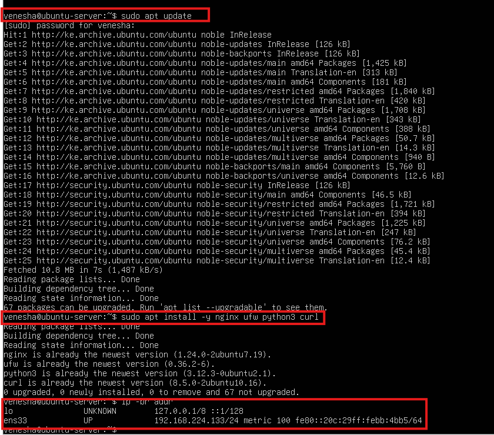

### For Kali

```bash
ip -br addr
```
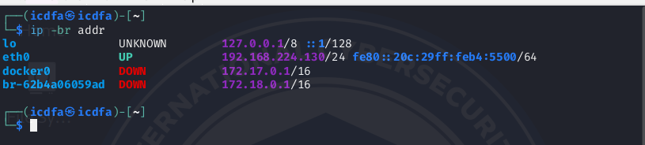

## Step 2 Create Fictional Content and a Legacy Service

```bash
sudo mkdir -p /var/www/grc-lab/public /var/www/grc-lab/archive /srv/grc-legacy

printf 'Approved internal portal\n' | sudo tee /var/www/grc-lab/public/index.html

printf 'DUMMY RECORD A001 - training only\n' | sudo tee /var/www/grc-lab/archive/dummy-records.txt

printf 'Legacy training endpoint\n' | sudo tee /srv/grc-legacy/index.html

sudo chmod -R a+rX /var/www/grc-lab /srv/grc-legacy
```
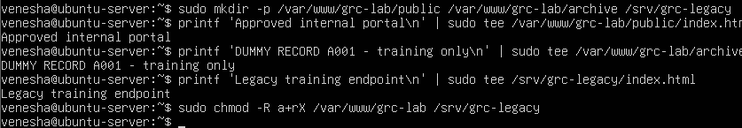

Create a lab-only systemd unit. This service is deliberately unnecessary; it contains no real data.

```bash
sudo tee /etc/systemd/system/grc-legacy.service > /dev/null <<'EOF'
[Unit]
Description=GRC lab legacy endpoint

[Service]
User=www-data
ExecStart=/usr/bin/python3 -m http.server 8080 --bind 0.0.0.0 --directory /srv/grc-legacy

[Install]
WantedBy=multi-user.target
EOF
```
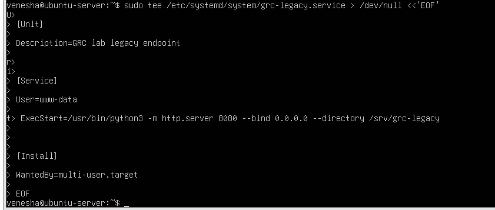

```bash
sudo systemctl daemon-reload
sudo systemctl enable --now grc-legacy
```
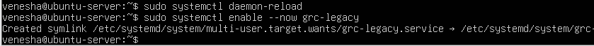

### Verification
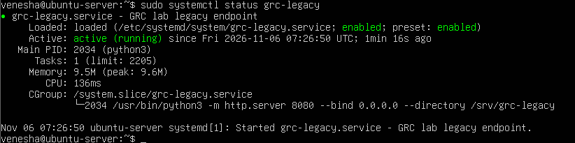

## Step 3 Configure the Lab Web Service

```bash
sudo tee /etc/nginx/sites-available/grc-lab > /dev/null <<'EOF'
server {
    listen 80;
    server_name _;
    root /var/www/grc-lab;
    access_log /var/log/nginx/grc_access.log combined;
    error_log /var/log/nginx/grc_error.log;
    location / { autoindex on; }
}
EOF
```
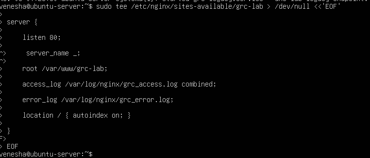

```bash
sudo ln -s /etc/nginx/sites-available/grc-lab /etc/nginx/sites-enabled/grc-lab
sudo rm -f /etc/nginx/sites-enabled/default
sudo nginx -t && sudo systemctl reload nginx
```
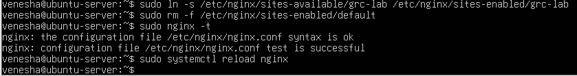

# 2 Measure Risk and Remove Exposure

## Step 4 Collect Baseline Evidence from Kali

Set SERVER_IP to your Ubuntu isolated-network address. Do not include angle brackets. Kali requires curl and Nmap. Save all evidence in a dedicated folder.

```bash
mkdir -p ~/grc-treatment-evidence
cd ~/grc-treatment-evidence

SERVER_IP=192.168.56.20
date -Is | tee baseline-time.txt
```
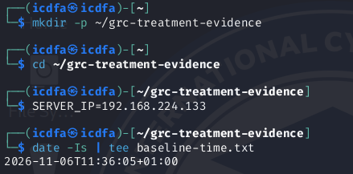

```bash
nmap -sT -p 80,8080 "$SERVER_IP" -oN baseline-ports.txt
```
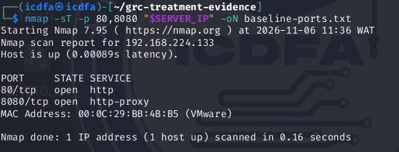

```bash
curl -i "http://$SERVER_IP/" | tee baseline-web.txt
```
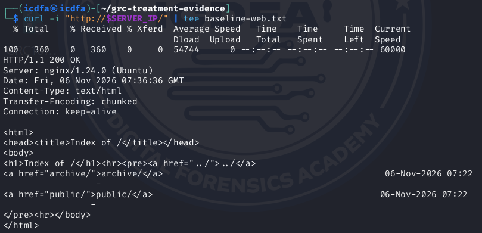

```bash
curl -i "http://$SERVER_IP/archive/" | tee baseline-listing.txt
```
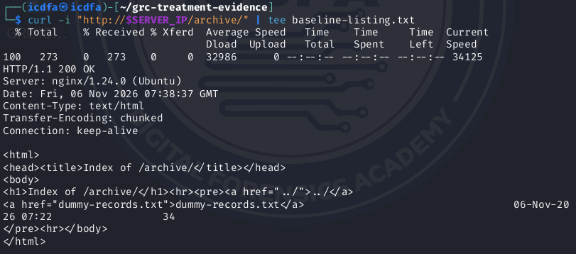

```bash
curl -i "http://$SERVER_IP/archive/dummy-records.txt" | tee baseline-file.txt
```
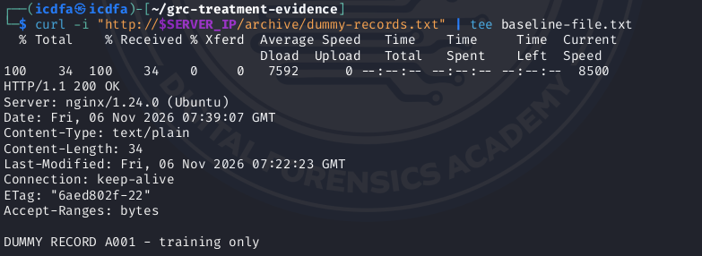

```bash
curl -i "http://$SERVER_IP:8080/" | tee baseline-legacy.txt
```
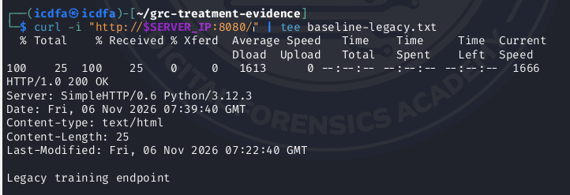

Expected baseline: ports 80 and 8080 are reachable; the root and archive directories list files; the dummy file is retrievable.

On Ubuntu:

```bash
sudo ufw status verbose
sudo ss -lntp
```

If the clean lab already has firewall restrictions, resolve them on this disposable VM before collecting the baseline; do not alter a production firewall.

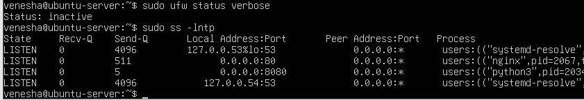

## Step 5 Create a baseline risk register
Create four entries: R1 unnecessary legacy service, R2 exposed archive, R3 unauthorised network access and R4 loss of portal content. For each record the asset, threat event, observed weakness, impact, likelihood, evidence reference and treatment owner.
For this exercise use likelihood 1–5 and impact 1–5; score = likelihood × impact. Bands: 1–4 Low, 5–9 Medium, 10–16 High, 17–25 Critical. These are classroom decision thresholds, not an external standard. Scores are ordinal and must not be interpreted as monetary loss or statistical probabilities.

# 5.1 Risk Assessment Methodology

The assessment applies a qualitative 5 × 5 risk matrix to evaluate the likelihood and potential business impact of identified vulnerabilities before the implementation of security controls.

\[
\text{Risk Score}=\text{Likelihood}\times\text{Impact}
\]

The following classification thresholds are applied as specified in the assignment.

| Risk Score | Risk Rating | Recommended Response |
|------------|------------|----------------------|
| 1-4 | Low | Accept or monitor |
| 5-9 | Medium | Planned treatment |
| 10-16 | High | Prioritised risk treatment |
| 17-25 | Critical | Immediate escalation and treatment |

The ratings represent classroom risk prioritisation thresholds and are not externally prescribed standards. Likelihood and impact scores are ordinal assessments and must not be interpreted as financial losses or statistical probabilities.

## 5.2 Baseline Risk Register

The following risk register uses verified technical findings from the lab wherever available. The likelihood and impact scores are professional assessment judgments based on those observations and the fictional business scenario.

| Risk ID | Asset | Threat Event | Observed Weakness | Impact (1-5) | Likelihood (1-5) | Risk Score | Risk Rating | Evidence Reference | Treatment Owner |
|----------|--------|-------------|-------------------|--------------|------------------|------------|------------|-------------------|----------------|
| R1 - Unnecessary Legacy Service | Legacy HTTP endpoint - TCP 8080 | Unauthorised interaction with or exploitation of an unnecessary legacy service, potentially compromising server security or availability. | Nmap confirmed TCP 8080 open on 192.168.224.133. A direct HTTP request returned 200 OK, identifying SimpleHTTP/0.6 Python/3.12.3 and exposing the legacy training endpoint. | 4 | 4 | 16 | High | baseline-ports.txt, baseline-legacy.txt; report pp. 6 and 8 | IT Infrastructure / Server Administrator |
| R2 - Exposed Archive Directory | Internal document archive and dummy records | Unauthorised browsing and retrieval of archived documents, resulting in potential confidentiality breaches. | Nginx directory listing was enabled. Requests to /archive/ and /archive/dummy-records.txt returned 200 OK, allowing retrieval of DUMMY RECORD A001 - training only without authentication. | 4 | 4 | 16 | High | baseline-web.txt, baseline-listing.txt, baseline-file.txt; report pp. 7-8 | Information Asset Owner / Web Administrator |
| R3 - Unauthorised Network Access | Internal web server and network services | An unauthorised network device accesses exposed services without approved source-IP restrictions. | UFW reported Status: inactive. Ubuntu showed services listening on 0.0.0.0:80 and 0.0.0.0:8080, while Kali successfully connected to both ports. | 4 | 3 | 12 | High | sudo ufw status verbose, sudo ss -lntp, baseline-ports.txt; report pp. 6 and 8 | Network Security Administrator |
| R4 - Loss of Portal Content | Approved internal portal - /var/www/grc-lab/public/index.html | Accidental deletion or corruption of portal files causes service unavailability and disruption of approved internal operations. | The approved portal file was created and the web service was accessible. However, the submitted baseline evidence does not demonstrate a protected backup or successful restoration capability. Recovery effectiveness remains unverified. | 4 | 3 | 12 | High | Step 2 portal-file creation, p. 4; Step 4 baseline-web.txt, p. 7; recovery testing pending | IT Operations / Backup and Recovery Administrator |

## 5.3 Evidence-Based Risk Analysis

### R1 - Unnecessary Legacy Service (High Risk: 16)

The baseline Nmap scan performed from Kali Linux against Ubuntu Server (192.168.224.133) confirmed that TCP ports 80 and 8080 were open. The subsequent HTTP request to port 8080 returned HTTP/1.0 200 OK, identifying a Python SimpleHTTP server and displaying the legacy training endpoint.

This confirms that the unnecessary service was remotely accessible within the lab network, unnecessarily expanding the server's attack surface.

Although no exploitation was demonstrated, continued exposure introduces an avoidable opportunity for unauthorised interaction, service misuse or exploitation of future vulnerabilities.

**Recommended treatment - Risk Avoidance:** Retire the legacy service using `sudo systemctl disable --now grc-legacy` while preserving the approved Nginx service on port 80. Validate the change through post-treatment Nmap and HTTP tests.

### R2 - Exposed Archive Directory (High Risk: 16)

The baseline HTTP tests confirmed that Nginx permitted directory listing at the root and archive paths. The request to `/archive/` returned HTTP/1.1 200 OK, exposing a directory index containing `dummy-records.txt`.

A direct request to `/archive/dummy-records.txt` also returned HTTP/1.1 200 OK, revealing the fictional record DUMMY RECORD A001 - training only.

These results demonstrate that archived content could be discovered and retrieved without authentication or access restrictions.

**Recommended treatment - Risk Mitigation:** Relocate the archive outside the Nginx web root, restrict filesystem permissions, disable directory listing and configure explicit HTTP 403 denial for the retired archive path.

### R3 - Unauthorised Network Access (High Risk: 12)

The Ubuntu baseline firewall assessment returned Status: inactive, confirming that UFW was not enforcing host-based filtering rules.

The `ss -lntp` output identified services listening on `0.0.0.0:80` and `0.0.0.0:8080`. Kali's Nmap scan independently confirmed that both ports were accessible from the test machine.

These observations establish that the server lacked host-based restrictions limiting access to an explicitly approved source address. They do not establish exposure to the public internet.

**Recommended treatment - Risk Mitigation:** Implement a default-deny UFW policy, permit HTTP access only from the approved Kali IP address and validate both permitted and blocked requests using firewall rules, connectivity tests and log evidence.

### R4 - Loss of Portal Content (High Risk: 12)

The baseline implementation created the approved portal content at `/var/www/grc-lab/public/index.html`, and the Nginx service was confirmed to be accessible through HTTP.

However, the evidence provided does not establish that the portal has a protected backup or that its content can be successfully restored following deletion or corruption.

This presents a potential availability and recoverability risk. The assessment reflects the absence of demonstrated recovery assurance rather than evidence that a data-loss incident has occurred.

**Recommended treatment - Risk Mitigation and Transfer Evaluation:** Create a protected local backup, record the original file's SHA-256 hash, simulate deletion and perform a verified restoration. Evaluate managed backup services as a potential risk-sharing arrangement while retaining organisational responsibility for recovery assurance.

## Step 6 Apply Avoidance to the Legacy Workflow

### Proposed Change Record

| Change Item | Details |
|------------|---------|
| Change Description | Retire the unused legacy HTTP endpoint (TCP 8080) while retaining the approved Nginx portal on TCP 80. |
| Business Impact | Reduces attack surface by removing an unnecessary service without affecting the approved web portal. |
| Approval Role | Information Security Manager / IT Infrastructure Manager |
| Approval Status | **SIMULATED APPROVAL - Classroom Exercise Only** |
| Pre-Implementation Test | Confirm ports 80 and 8080 are accessible and the legacy endpoint returns HTTP 200 OK. |
| Rollback Procedure | Re-enable the legacy service using `sudo systemctl enable --now grc-legacy`. |
| Success Criteria | TCP port 8080 closed, legacy endpoint inaccessible, TCP port 80 remains operational, approved portal remains accessible. |

### 6.1 Risk Avoidance Implementation

**EXECUTE ON UBUNTU SERVER**

```bash
sudo systemctl disable --now grc-legacy
sudo systemctl is-active grc-legacy
sudo ss -lntp
```
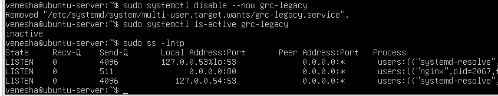

---

### 6.2 Post-Treatment Validation from Kali Linux

**EXECUTE ON KALI LINUX**

```bash
nmap -sT -p 80,8080 "$SERVER_IP" -oN avoidance-ports.txt
```

```bash
curl -i "http://$SERVER_IP:8080/" | tee avoidance-legacy.txt
```

```bash
curl -i "http://$SERVER_IP/public/"
```
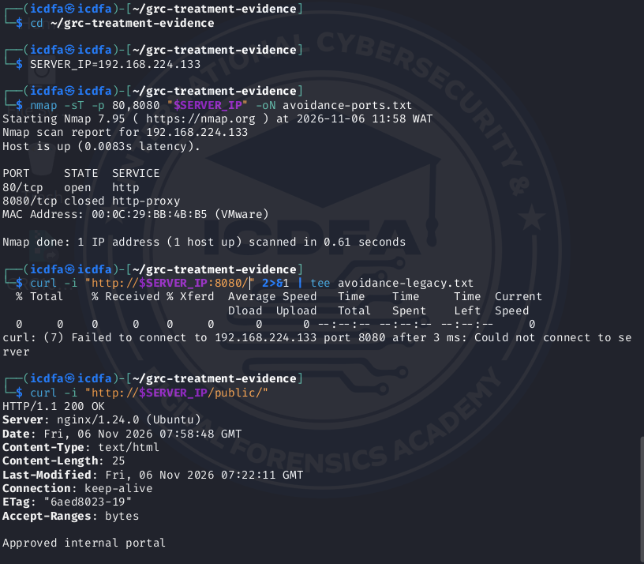

### 6.3 Rollback Procedure
If the change causes an unexpected operational issue, the legacy service can be restored using the following command.
EXECUTE ON UBUNTU SERVER
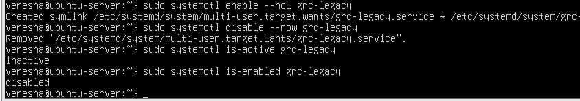

## 6.4 Risk Treatment Analysis and Before-and-After Comparison

The risk avoidance treatment was successfully implemented and validated on the Northbridge Services Ubuntu Server (192.168.224.133). The legacy HTTP service operating on TCP port 8080 was disabled, while the approved Nginx web service on TCP port 80 remained operational.

The Ubuntu Server verification confirmed that grc-legacy.service changed to an inactive state and was no longer listening on TCP port 8080. The Kali Linux Nmap scan independently confirmed that port 8080 had changed from open to closed, while port 80 remained open.

Additionally, the HTTP request to the retired legacy endpoint failed with curl error (7), confirming that the service was no longer accessible. The approved portal continued to return HTTP/1.1 200 OK and displayed the expected content, Approved internal portal.

### 6.4.1 Before-and-After Risk Treatment Comparison

| Validation Criteria | Baseline – Step 4 | Post-Treatment – Step 6 | Assessment |
|--------------------|-------------------|-------------------------|------------|
| Legacy service status | Active (running) | Inactive | Successful |
| Legacy startup configuration | Enabled | Disabled | Successful |
| TCP port 8080 | Open | Closed | Successful |
| Legacy HTTP endpoint | HTTP 200 OK | Connection failed – curl error (7) | Successful |
| TCP port 80 | Open | Open | Successful |
| Approved Nginx portal | HTTP 200 OK | HTTP 200 OK | Successful |
| Portal content | Approved internal portal | Approved internal portal | Preserved |
| Final treatment state | Legacy service enabled | Legacy service inactive and disabled | Successful |

The results demonstrate that the risk avoidance control achieved its intended technical objective without interrupting the approved web service.

### 6.4.2 Rollback and Final-State Verification

A rollback command was executed using `sudo systemctl enable --now grc-legacy`, followed by reapplication of the risk avoidance treatment using `sudo systemctl disable --now grc-legacy`.

Final verification confirmed:

- `sudo systemctl is-active grc-legacy` returned **inactive**.
- `sudo systemctl is-enabled grc-legacy` returned **disabled**.
- The previously collected Kali evidence confirmed that TCP port 8080 was closed and the approved portal remained accessible.

The rollback command was executed, demonstrating that the service could be re-enabled at the configuration level. However, the screenshots do not include an intermediate HTTP or service-status verification while the legacy service was temporarily restored. Therefore, a fully validated rollback cannot be claimed.

### 6.4.3 Effectiveness and Remaining Risk

The control represents risk avoidance because Northbridge Services discontinued the unnecessary legacy workflow responsible for the identified exposure rather than continuing to operate it with additional security restrictions.

The successful closure of TCP port 8080 removes the network-accessible exposure associated with the retired service. However, this does not eliminate the server's overall cybersecurity risk.

The following exposures remain relevant:

- **R2 - Exposed Archive:** The archive requires access restrictions to prevent unauthorised document retrieval.
- **R3 - Unauthorised Network Access:** The approved web service requires source-IP restrictions through UFW.
- **R4 - Loss of Portal Content:** Protected backups and verified restoration are required to address availability and recovery risks.

Consequently, additional preventive, detective and corrective controls remain necessary to reduce the residual risk associated with the approved Nginx service.

# 3 Implement and Test Preventive Controls
## Step 7 Remove Archive Publication

On Ubuntu, move the archive outside the web root and restrict it to root. Add an explicit denial for the old URL. This both removes web publication and blocks the retired path.

```bash
sudo mkdir -p /srv/grc-private
sudo mv /var/www/grc-lab/archive /srv/grc-private/
sudo chmod -R go-rwx /srv/grc-private
```

```bash
sudo tee /etc/nginx/sites-available/grc-lab > /dev/null <<'EOF'
server {
    listen 80;
    server_name _;
    root /var/www/grc-lab;
    access_log /var/log/nginx/grc_access.log combined;
    error_log /var/log/nginx/grc_error.log;

    location / { autoindex off; }

    location /archive/ { deny all; }
}
EOF
```
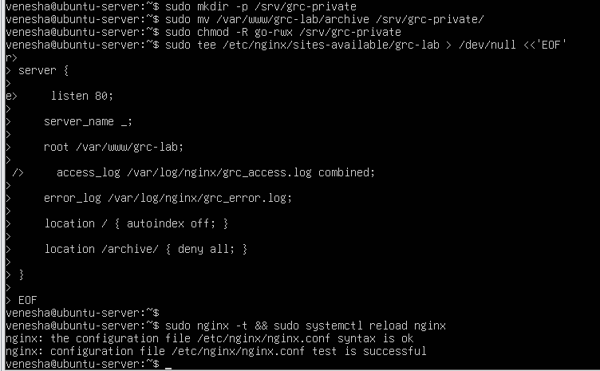

```bash
sudo nginx -t && sudo systemctl reload nginx
```
From Kali, verify /public/ remains HTTP 200, while /archive/ and /archive/dummy-records.txt return HTTP 403. Verify / returns 403 because directory listing is disabled and no root index exists. Save responses and explain why disabling listings alone would not prevent direct-file access.

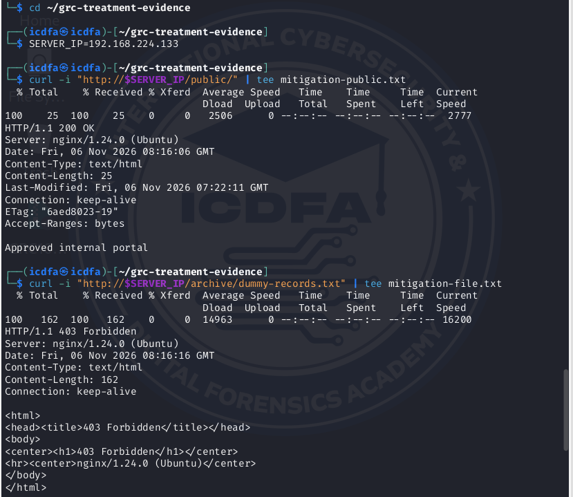

## Step 8 Restrict Network Access with UFW

Use the Ubuntu VM console, not an SSH-only connection.

```bash
KALI_IP=192.168.56.10
```

```bash
sudo ufw default deny incoming
sudo ufw default allow outgoing
sudo ufw allow from "$KALI_IP" to any port 80 proto tcp
sudo ufw logging on
sudo ufw enable
sudo ufw status numbered
```
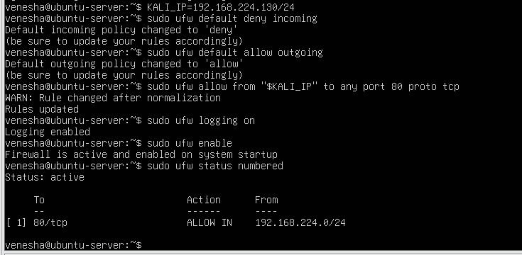

From the approved Kali address, request /public/ and confirm HTTP 200. For a blocked-source test use another VM, or add a second unused address on Kali’s isolated interface. First confirm the interface name with ip -br addr; replace eth0 and the sample address below with valid lab values. Ensure the second address is unused and in the same subnet.

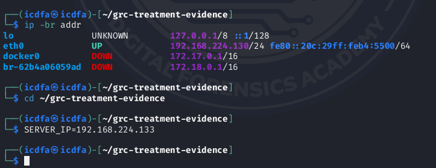

```bash
sudo ip addr add 192.168.56.11/24 dev eth0

curl --interface 192.168.56.11 --connect-timeout 5 "http://$SERVER_IP/public/"

sudo ip addr del 192.168.56.11/24 dev eth0
```
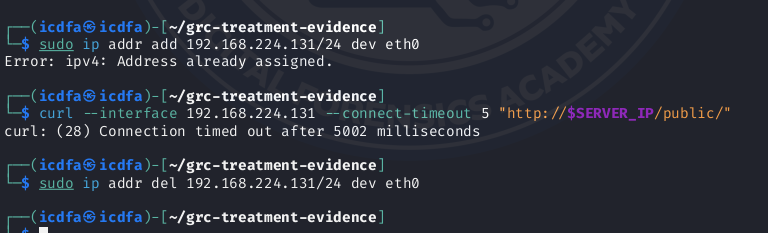

Expected: the unapproved source times out and does not receive the portal. Record the source address and timestamp. A timeout alone is insufficient proof: retain UFW rule output and corroborating firewall logs. Restore normal access if testing fails; console rollback is sudo ufw disable. Reapply the intended rules afterwards.

### Record the source IP address and timestamp
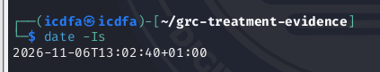

### Retain UFW rule output
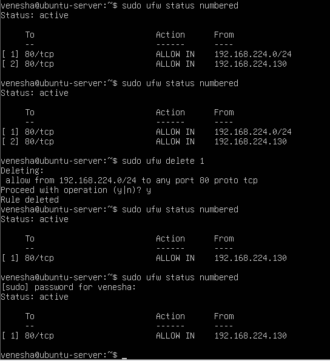

### corroborating firewall log


### Restore normal access if testing fails
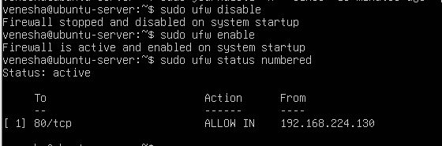

# 4 Verify Detection and Recovery

## Step 9 Correlate Control Evidence

From the approved Kali address, request `/public/`, then `/archive/`. Record timestamps.
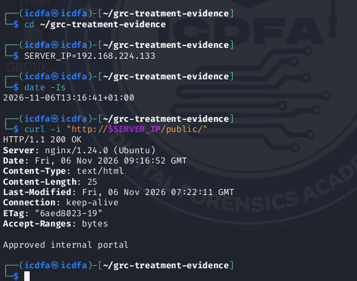

On Ubuntu inspect the web and firewall logs:

```bash
sudo tail -n 30 /var/log/nginx/grc_access.log
```

```bash
sudo journalctl -k --since '15 minutes ago' | grep 'UFW BLOCK'
```
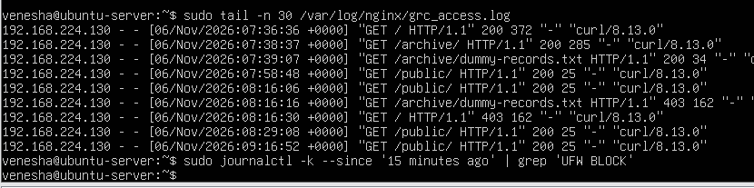

If kernel events are unavailable in the journal, inspect /var/log/ufw.log if present. Repeat a blocked-source request and allow time for log output; firewall logging can be rate-limited. Do not fabricate missing events. Document collection problems and distinguish an unverified control from a failed control.
Explain which requests appear in Nginx logs and why firewall-blocked traffic should not reach Nginx. Produce an evidence table with test ID, source IP, requested service, expected outcome, actual outcome, timestamp and log reference.

## 9.1 UFW Firewall Log Verification - Confirmed Results

| Log Field | Actual Result | Interpretation |
|------------|--------------|----------------|
| Firewall action | UFW BLOCK | Firewall blocked the connection |
| Source IP | 192.168.224.131 | Unauthorised Kali test address |
| Destination IP | 192.168.224.133 | Ubuntu Server |
| Destination port | 80 | Nginx HTTP service |
| Protocol | TCP | Network connection attempt |
| Timestamp | 6 November 2026, 08:31:41 UTC | Recorded firewall event |

These results establish that the firewall logged attempts from the unapproved source to access the HTTP service.

## 9.2 Updated Control Evidence Table

| Test ID | Source IP | Requested Service | Expected Outcome | Actual Outcome | Timestamp (UTC) | Log Reference |
|----------|------------|-------------------|------------------|----------------|----------------|--------------|
| LOG-01 | 192.168.224.130 | /public/ - TCP 80 | HTTP 200 | HTTP 200 – Passed | 09:16:52 | grc_access.log |
| LOG-02 | 192.168.224.130 | /archive/ - TCP 80 | HTTP 403 | Post-treatment request not yet verified | Pending | grc_access.log |
| LOG-03 | 192.168.224.131 | /public/ - TCP 80 | Connection blocked | UFW BLOCK confirmed, TCP 80 | 08:31:41 | /var/log/ufw.log |

## 9.5 Explanation of the Log Correlation

The log correlation demonstrates that Nginx and UFW operate at different security-control layers.

Nginx records HTTP requests that reach the web server, including successful requests to the approved portal and requests denied through application-level access restrictions.

UFW blocks unauthorised network traffic before it reaches Nginx. Consequently, requests blocked by UFW should not produce corresponding entries in the Nginx access log.

The confirmed UFW BLOCK entries identify the unapproved source 192.168.224.131, destination 192.168.224.133, and destination TCP port 80. This corroborates that the firewall enforced the source-IP access restriction during the blocked-source test.

## 9.6 Step 9 Conclusion

The Step 9 assessment confirms that Nginx access logging and UFW firewall logging are operational.

Nginx recorded successful requests to the approved portal and denied access to restricted resources. UFW independently recorded blocked TCP connection attempts originating from the unapproved Kali address.

These findings provide evidence that the implemented controls are generating security monitoring records suitable for compliance assessment and audit verification.

---

## Step 10 Back Up and Recover the Approved Portal

On Ubuntu, create a protected backup and a hash of the original dummy portal file. Record the start time of the recovery exercise.

```bash
sudo mkdir -p /srv/grc-backups

sudo chmod 700 /srv/grc-backups

sudo tar -czpf /srv/grc-backups/public-before-test.tgz -C /var/www/grc-lab public

sha256sum /var/www/grc-lab/public/index.html | tee ~/portal-before.sha256

date -Is

sudo rm /var/www/grc-lab/public/index.html
```
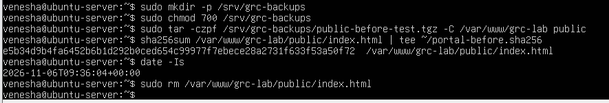

From Kali, confirm that `/public/` no longer returns the approved page.

```bash
curl -i "http://$SERVER_IP/public/"
```

Then restore on Ubuntu:

```bash
sudo tar -xzpf /srv/grc-backups/public-before-test.tgz -C /var/www/grc-lab

sha256sum -c ~/portal-before.sha256

date -Is
```
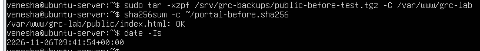

Verify HTTP 200 and the original content again from Kali. Evidence must show the failed service check, successful hash comparison and restored service. Calculate observed recovery time. Explain that a same-host backup is useful for this exercise but does not protect against complete host loss or compromise.
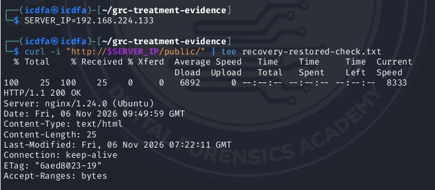

## 10.1 Recovery Verification and Findings

The corrective control was validated by restoring the approved portal from the protected backup archive and performing a SHA-256 integrity verification.

The restoration completed without reported errors, and the integrity check returned `/var/www/grc-lab/public/index.html: OK`, demonstrating that the restored file matched the original baseline hash.

A subsequent HTTP request from Kali Linux to `http://192.168.224.133/public/` returned **HTTP/1.1 200 OK** at **09:49:59 UTC on 6 November 2026**, confirming that the restored portal was accessible.

The recovery exercise demonstrates the effectiveness of the local backup in restoring portal content following simulated deletion. However, the measured end-to-end recovery duration remains dependent on the original recovery start timestamp.

**Limitation:** The same-host backup is suitable for demonstrating recovery from accidental file deletion, but it does not protect against complete host loss, storage failure or server compromise because both the live content and backup are stored on the same system.

## 10.2 Monitoring and Operational Handover

Define three measurable checks with owner, frequency, threshold and escalation: approved portal availability, unexpected open ports and recovery-test success. Include a configuration-drift check for the retired service. Distinguish the measured lab results from proposed ongoing monitoring.

### 10.2.1 Monitoring and Operational Handover Plan

Following the implementation of risk treatment controls, Northbridge Services requires ongoing monitoring to ensure that the approved internal portal remains available, unnecessary network services are not reintroduced, and backup and recovery controls continue to operate effectively.

The following monitoring framework defines measurable checks, responsible owners, monitoring frequencies, performance thresholds and escalation requirements.

| Monitoring Check | Control Objective | Responsible Owner | Frequency | Threshold / Success Criteria | Escalation |
|------------------|------------------|------------------|-----------|-----------------------------|------------|
| MC-01: Approved Portal Availability | Ensure the approved Nginx portal remains accessible to authorised users. | IT Operations / Web Administrator | Every 5 minutes | ≥99.9% monthly availability; successful HTTP 200 response from an approved source | Escalate to IT Operations after two consecutive failed checks; notify the IT Infrastructure Manager if service remains unavailable for 15 minutes. |
| MC-02: Unexpected Open Ports | Detect unauthorised services or changes to the approved network exposure. | Network Security Administrator | Daily and after configuration changes | Zero unexpected open ports; only approved TCP 80 accessible from the authorised testing address | Immediately investigate unexpected listening services; escalate confirmed unauthorised exposure to the Information Security Manager. |
| MC-03: Recovery-Test Success | Verify that the approved portal can be restored accurately following content loss. | Backup and Recovery Administrator | Quarterly and after major changes | 100% successful restoration tests; SHA-256 integrity verification passes and restored portal returns HTTP 200 | Escalate failed restoration or integrity checks to the IT Infrastructure Manager and initiate corrective remediation. |

**Note:** The frequencies, availability target and escalation thresholds above are proposed operational requirements for Northbridge Services. They are not measurements established by the laboratory exercise.

### 10.2.2 Configuration-Drift Monitoring for the Retired Legacy Service

To prevent the reintroduction of the unnecessary legacy endpoint identified under R1, Northbridge Services should implement configuration-drift monitoring.

| Monitoring Element | Proposed Requirement |
|-------------------|----------------------|
| Service | grc-legacy.service |
| Risk Reference | R1 – Unnecessary Legacy Service |
| Responsible Owner | System Administrator |
| Monitoring Frequency | Daily and after system changes or reboots |
| Expected Service State | inactive |
| Expected Startup Configuration | disabled |
| Expected Port State | TCP 8080 not listening |
| Compliance Threshold | 100% adherence to the approved retired-service configuration |
| Escalation Trigger | Service becomes active, enabled or TCP 8080 unexpectedly opens |
| Escalation Authority | IT Infrastructure Manager / Information Security Manager |

### 10.2.3 Measured Laboratory Results Versus Proposed Ongoing Monitoring

| Control Area | Measured Laboratory Result | Proposed Ongoing Monitoring |
|--------------|---------------------------|-----------------------------|
| Portal Availability | Kali Linux confirmed HTTP 200 responses from the approved portal, including following restoration. | Automated availability checks every 5 minutes, targeting ≥99.9% monthly availability. |
| Network Exposure | Following risk avoidance, Nmap confirmed TCP 8080 closed while TCP 80 remained open. | Daily port scanning and configuration-change monitoring to identify unexpected services. |
| Firewall Enforcement | UFW logs confirmed blocked TCP traffic from 192.168.224.131 to 192.168.224.133 on port 80. | Regular firewall-rule reviews and investigation of unauthorised connection attempts. |
| Recovery Effectiveness | The portal was restored from a local backup, SHA-256 verification returned OK, and Kali confirmed HTTP 200. | Quarterly restoration exercises with documented recovery duration and integrity verification. |
| Legacy Service Configuration | Final systemd checks confirmed the legacy service was inactive and disabled. | Daily configuration-drift checks to verify that the legacy service remains retired. |

The laboratory evidence demonstrates successful execution of specific control tests at the time of assessment. It does not establish continuous service availability, long-term firewall effectiveness, recurring backup reliability or ongoing compliance with monitoring thresholds.

### 10.2.4 Operational Handover and Escalation

The IT Operations team will be responsible for monitoring portal availability and coordinating recovery activities. The Network Security Administrator will oversee network exposure and firewall-rule compliance, while the System Administrator will maintain the approved configuration baseline.

Monitoring exceptions should be recorded in an operational control register containing the affected system, detection timestamp, control deviation, responsible owner, corrective action, escalation status and closure evidence.

Any unexpected exposure, repeated availability failure, unsuccessful restoration test or reactivation of the retired legacy service should trigger investigation and escalation in accordance with the defined thresholds.

Control deficiencies should only be closed after corrective actions have been implemented and their effectiveness independently verified through appropriate technical evidence.

### 10.2.5 Conclusion

The monitoring and operational handover plan establishes measurable requirements for maintaining the effectiveness of Northbridge Services' implemented security controls.

The laboratory results provide evidence of successful portal accessibility, closure of the unnecessary legacy endpoint, firewall blocking and verified file restoration. However, these results represent point-in-time testing rather than continuous operational assurance.

The proposed monitoring activities introduce defined ownership, performance thresholds, review frequencies and escalation procedures to support the continued effectiveness of risk treatment measures.

# 5 Evaluate Decisions and Submit Evidence

## Step 11 Model Transfer and Acceptance
Transfer exercise: compare a fictional managed-backup offer at $120 setup plus $20/month against local-only backup. State the provider duties, retained customer duties, restoration-test requirement, evidence-retention requirement and service limitation. Draft a proposed service clause; do not claim that a contract or insurance removes the technical risk. No actual purchase is required.
Acceptance exercise: evaluate whether plain HTTP may be temporarily retained on this isolated network with dummy data only. Record owner, residual risk score, rationale, proposed 14-day expiry, review date and triggers such as real data, external connectivity or broader use. Label approval simulated. If outside the classroom appetite, recommend escalation or further treatment instead of acceptance.

### 11.1 Risk Transfer - Managed Backup Service

#### 11.1.1 Risk Context and Treatment Objective

The baseline risk assessment identified R4 - Loss of Portal Content, with an inherent risk score of 12 (High). This risk concerns potential disruption of the approved internal portal following accidental deletion, corruption or loss of critical files.

Following the recovery exercise, the restored file passed integrity verification, returning `/var/www/grc-lab/public/index.html: OK`. A subsequent Kali Linux HTTP request returned **HTTP/1.1 200 OK**, confirming restoration of portal accessibility.

Although this demonstrates recovery from file-level deletion, the backup remains on the same Ubuntu server as the original content. Consequently, complete host failure, storage failure or server compromise could affect both the operational data and the backup.

The proposed risk transfer arrangement involves engaging a fictional managed-backup provider to assume defined backup operational responsibilities while Northbridge Services retains accountability for information security, recovery assurance and residual risk.

### 11.1.2 Comparison of Local-Only and Managed Backup

| Evaluation Criteria | Local-Only Backup - Current Lab Control | Managed Backup - Proposed Arrangement |
|--------------------|-------------------------------------------|--------------------------------------|
| Backup Approach | Locally created compressed archive using tar | Backup operations managed by an external service provider |
| Setup Cost | No separate setup fee specified; existing lab infrastructure used | $120 |
| Recurring Cost | Not separately quantified in the exercise | $20 per month |
| First-Year Cost | Not quantified | $360 |
| Backup Storage | Same Ubuntu Server (/srv/grc-backups) | Separately protected provider-managed storage, subject to contract |
| Operational Responsibility | Internal System Administrator | Provider performs contracted backup operations |
| Recovery Validation | Manual restoration and SHA-256 verification | Contractually required restoration testing with customer oversight |
| Exposure to Complete Host Loss | High, because backup and source share the same host | Potentially reduced through separate storage, subject to provider implementation |
| Monitoring and Evidence | Locally maintained command outputs and screenshots | Provider-generated backup reports, restoration evidence and service records |
| Residual Risk | Host compromise, storage failure and backup corruption remain possible | Provider failure, incomplete backups, recovery delays and contractual limitations remain possible |

The managed-backup option has a fictional first-year cost of:

**$120 + (12 × $20) = $360**

The local-only backup remains suitable for the controlled laboratory exercise. However, its effectiveness against complete host loss has not been demonstrated. The proposed managed service provides an opportunity to share operational backup responsibilities and improve recovery resilience, depending on its contractual and technical safeguards.

### 11.1.3 Provider and Customer Responsibilities

| Responsibility Area | Managed-Backup Provider Duties | Northbridge Services' Retained Duties |
|--------------------|--------------------------------|--------------------------------------|
| Backup Execution | Perform scheduled backups according to the agreed service schedule. | Identify systems and files requiring protection. |
| Backup Protection | Maintain agreed storage security, access restrictions and backup integrity safeguards. | Classify data and approve security requirements. |
| Backup Monitoring | Monitor backup jobs, identify failures and report exceptions. | Review reports and escalate unresolved deficiencies. |
| Restoration Testing | Support documented restoration tests and provide evidence of results. | Validate restored data integrity and application availability. |
| Incident Management | Notify Northbridge Services of backup-related incidents or service failures within agreed timelines. | Manage business impact, incident escalation and recovery decisions. |
| Evidence Retention | Retain backup execution logs, restoration reports and incident records for the agreed period. | Review and preserve relevant assurance evidence for audit purposes. |
| Risk Governance | Fulfil contractual obligations and report service performance. | Retain ownership of R4 and responsibility for residual risk acceptance. |

The provider assumes defined operational duties, but Northbridge Services remains accountable for managing its information assets and ensuring that recovery arrangements meet business requirements.

### 11.1.4 Restoration Testing and Evidence Retention Requirements

The proposed managed-backup arrangement should include the following contractual requirements.

**Restoration testing:** The provider and Northbridge Services should conduct documented restoration tests at least quarterly and after material changes affecting backup scope or recoverability. Each test should verify file integrity, successful restoration and the availability of the approved portal. Failed tests must trigger investigation, corrective action and retesting.

**Evidence retention:** The provider should retain backup execution records, failure notifications, restoration-test results, integrity verification reports and remediation evidence for a proposed minimum of 12 months, or longer where organisational or applicable requirements demand it.

The quarterly testing frequency and 12-month retention period are proposed contractual requirements, not existing Northbridge Services policies or values measured during the laboratory.

### 11.1.5 Proposed Managed-Backup Service Clause

**Proposed Contractual Clause - Backup, Restoration and Evidence Assurance**

The Service Provider shall perform scheduled backups of the systems and data designated by Northbridge Services and maintain those backups in appropriately secured storage separate from the primary production host.

The Service Provider shall monitor backup execution, notify Northbridge Services of failed or incomplete backup operations, and implement corrective actions within contractually agreed service levels.

Documented restoration testing shall be conducted at least quarterly and following material changes affecting recovery capability. Restoration evidence shall include test dates, recovery outcomes, integrity verification results, identified deficiencies and corrective actions.

The Service Provider shall retain backup execution records, restoration-test reports and relevant incident evidence for a minimum proposed period of 12 months and make such records available to Northbridge Services for authorised security reviews and audits.

Northbridge Services shall retain responsibility for defining backup scope, approving recovery requirements, reviewing service performance and managing residual risks. The agreement shall not be interpreted as eliminating technical risks associated with data loss, service interruption, provider failure or cybersecurity incidents.

### 11.1.6 Service Limitations and Transfer Decision

The proposed arrangement transfers defined backup operational responsibilities but does not eliminate the technical risk of data loss or service disruption. The provider may experience service outages, unsuccessful backup jobs, security incidents or restoration failures. Contractual remedies also cannot guarantee immediate recovery or replace lost business operations.

**Treatment Decision:** Evaluate the fictional managed-backup arrangement as a supplementary treatment for R4. No actual purchase or contract execution is required for this exercise. Implementation would remain subject to provider due diligence, contractual approval, recovery testing and ongoing assurance.

---

## 11.2 Risk Acceptance - Temporary Retention of Plain HTTP

### 11.2.1 Risk Context

The Northbridge Services internal portal currently operates over plain HTTP on TCP port 80. HTTP does not provide transport-layer encryption, meaning transmitted information may be exposed to interception or modification by an adversary with sufficient network access.

The laboratory, however, uses fictional content and an isolated network. The security controls implemented in previous steps include retirement of the legacy service, removal of archive publication and source-IP restrictions through UFW.

The results support evaluating temporary risk acceptance for the remaining unencrypted HTTP service, provided strict limitations are maintained.

### 11.2.2 Risk Acceptance Assessment

| Acceptance Element | Proposed Decision |
|-------------------|------------------|
| Risk ID | RA-HTTP-01 |
| Risk Description | Exposure to interception or modification of unencrypted HTTP traffic |
| Affected Asset | Approved Northbridge Services internal portal |
| Service | Nginx - TCP port 80 |
| Risk Owner | IT Infrastructure Manager |
| Approval Authority | Information Security Manager / Authorised Risk Owner |
| Existing Control Environment | Isolated lab network, dummy data, archive access restrictions and UFW source-IP filtering |
| Proposed Residual Likelihood | 2 - Unlikely |
| Proposed Residual Impact | 2 - Minor |
| Residual Risk Score | 4 - Low |
| Risk Treatment Decision | Conditional, temporary acceptance |
| Acceptance Duration | 14 days |
| Effective Date | 6 November 2026 |
| Expiry and Review Date | 20 November 2026 |
| Approval Status | Simulated approval - classroom exercise only |

The proposed residual risk score is calculated as:

**2 × 2 = 4 - Low**

This is an illustrative qualitative assessment for the isolated classroom environment. It is not a measured probability, a financial estimate or evidence that all HTTP-related threats have been eliminated.

### 11.2.3 Risk Acceptance Rationale

Temporary retention of plain HTTP may be acceptable within the controlled laboratory environment because the server processes fictional training data rather than genuine organisational or customer information.

The isolated network limits potential exposure, while the UFW firewall restricts access to the approved Kali testing address. The previous controls also removed the unnecessary legacy endpoint and restricted access to archived files.

The proposed Low residual risk rating reflects the limited data sensitivity, constrained network exposure and temporary nature of the exercise.

However, these measures do not provide encryption or guarantee protection against interception and modification by parties already positioned within the permitted communication path.

Acceptance is therefore conditional on maintaining the classroom environment's restrictions and must not be extended automatically to production or externally accessible services.

### 11.2.4 Risk Acceptance Conditions and Review Triggers

| Condition / Trigger | Required Response |
|--------------------|------------------|
| Real organisational or customer data is introduced | Immediately suspend acceptance and require encryption and reassessment. |
| Server gains external or public network connectivity | Revoke temporary acceptance and escalate for further risk treatment. |
| Portal use expands beyond the approved lab participants | Reassess likelihood, impact and access controls before continued operation. |
| Authentication credentials or sensitive information are transmitted | Require HTTPS/TLS before permitting the activity. |
| UFW restrictions are disabled or altered unexpectedly | Investigate immediately and suspend acceptance until controls are restored. |
| Material security incident or vulnerability is identified | Escalate to the Information Security Manager for reassessment. |
| The 14-day acceptance period expires | Review the risk and either implement further treatment or obtain a new documented decision. |

### 11.2.5 Simulated Risk Acceptance Decision

**Risk Acceptance Record - RA-HTTP-01**

**Decision:** Conditionally accept the residual risk associated with plain HTTP on the isolated Northbridge Services laboratory network for a maximum of 14 days, from 6 November 2026 to 20 November 2026.

**Justification:** The service contains dummy data only, operates within an isolated environment and is subject to access restrictions verified during the laboratory. The proposed residual risk score of 4 (Low) is considered within the assumed classroom risk appetite.

**Conditions:** The server must remain isolated, no real or sensitive data may be processed, approved access restrictions must remain effective, and any material change in connectivity or use must trigger reassessment.

**Approval Role:** Information Security Manager / Authorised Risk Owner

**Approval Status:** **SIMULATED - Classroom exercise only. No actual organisational risk acceptance has been authorised.**

**Review and Expiry Date:** 20 November 2026

**Recommended Follow-up:** Implement HTTPS/TLS before introducing genuine organisational data, expanding access or deploying the portal outside the isolated lab.

If the assessed risk exceeds the classroom risk appetite, temporary acceptance should not proceed. The matter should instead be escalated to the authorised risk owner for additional treatment, such as TLS deployment.


